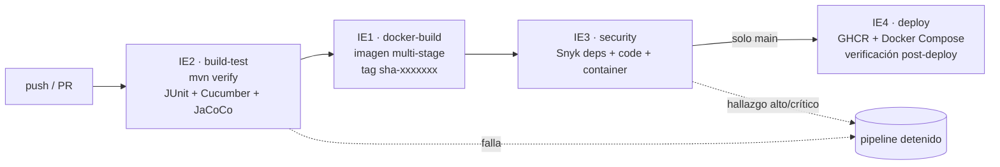
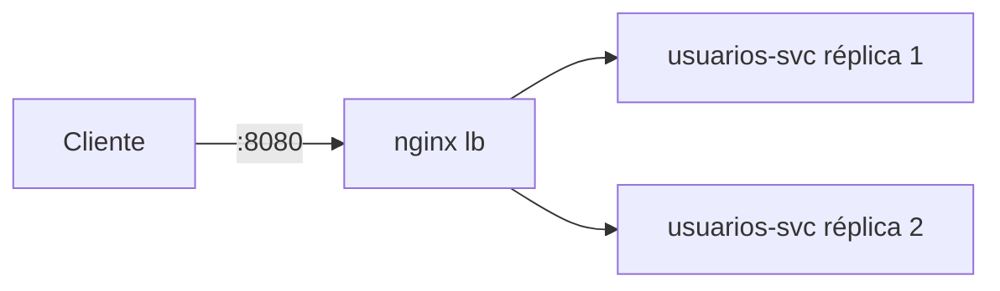

# Usuarios — Microservicio con pipeline CI/CD (EP2 DOY0101)


Microservicio **Usuarios** del caso **caso10 — CargoClick** (logística / courier), con un
pipeline CI/CD en **GitHub Actions** que construye, prueba, analiza la seguridad, despliega
y orquesta el servicio de forma automática y trazable.

| | |
|---|---|
| Stack | Spring Boot 3.3 · Java 21 · Maven · Spring Data JPA · H2 · springdoc-openapi · Actuator |
| Calidad | JUnit 5 + MockMvc · Cucumber (BDD) · JaCoCo (cobertura de líneas 100%, bloqueante) |
| Seguridad | Dependabot · Snyk Open Source · Snyk Code · Snyk Container (bloqueante) |
| Entrega | Docker multi-stage · GitHub Container Registry · Docker Compose (2 réplicas + nginx) |

**Integrantes:** Nicolás Tapia · Kevin Carazas — ver [reparto del trabajo](#9-reparto-del-trabajo)

---

## 1. El microservicio

Administra los datos y la lógica del dominio de Usuarios del caso caso10. Su base de datos es
una **H2 en memoria** (una base por microservicio, aislamiento de datos por dominio).

| Método | Ruta | Descripción |
|--------|------|-------------|
| GET | `/api/usuarios` | Lista todos los usuarios |
| GET | `/api/usuarios/{id}` | Obtiene un usuario por id |
| POST | `/api/usuarios` | Crea un usuario (`nombre` obligatorio) |
| PUT | `/api/usuarios/{id}` | Actualiza un usuario |
| DELETE | `/api/usuarios/{id}` | Elimina un usuario |
| GET | `/actuator/health` | Estado del servicio (usado por healthchecks y deploy) |
| GET | `/actuator/info` | Versión y **commit** desplegado (trazabilidad) |

Documentación interactiva: `/swagger-ui/index.html`, `/redoc.html`, `/v3/api-docs.yaml`.
Más detalle en [`docs/`](docs/) (arquitectura, API, pruebas, diagramas C4).

### Cómo ejecutarlo

```bash
# Local (Java 21 + Maven)
mvn spring-boot:run                 # http://localhost:8080

# Con Docker Compose (2 réplicas + balanceador)
docker compose up -d --build --wait
curl http://localhost:8080/actuator/health
docker compose down
```

---

## 2. Pipeline CI/CD

Archivo: [`.github/workflows/pipeline.yml`](.github/workflows/pipeline.yml). Se ejecuta en cada
**push** y **Pull Request** a `main` (y manualmente con *Run workflow*).



| Etapa | Qué hace | Si falla… |
|-------|----------|-----------|
| `build-test` | Compila, corre pruebas unitarias, BDD y verifica cobertura. Publica reportes. | No se construye imagen |
| `docker-build` | Construye la imagen, verifica que no corra como root y tenga HEALTHCHECK, la guarda como artefacto. | No se escanea ni despliega |
| `security` | Snyk analiza dependencias, código e imagen. Publica alertas en *Security*. | **No se despliega** |
| `deploy` | Publica la imagen en GHCR, levanta Compose, verifica salud y versión, crea tag git y registra el despliegue. | Queda registrado como fallido |

La imagen que se despliega es **la misma** que se probó y escaneó (se pasa entre jobs como
artefacto), no se reconstruye.

---

## 3. IE1 — Contenedor optimizado

[`Dockerfile`](Dockerfile) multi-stage:

| Decisión | Por qué |
|----------|---------|
| Etapa `build` con `maven:3.9-eclipse-temurin-21` | Compila; se descarta al final, no llega a la imagen final. |
| Etapa final `eclipse-temurin:21-jre-alpine` | Solo JRE sobre Alpine: imagen mucho más liviana y con menos superficie de ataque. |
| `COPY pom.xml` antes que `src` + caché de `~/.m2` | Las dependencias se reutilizan entre builds; compilar es más rápido. |
| Usuario `app` (no root) | Si el proceso es comprometido no tiene privilegios de root. |
| `HEALTHCHECK` contra `/actuator/health` | Docker sabe si el servicio realmente responde, no solo si el proceso existe. |
| `-XX:MaxRAMPercentage=75` | La JVM respeta el límite de memoria del contenedor. |
| `exec java …` | Java es PID 1 y recibe `SIGTERM` para apagarse limpio. |
| Labels OCI `revision` / `version` | La imagen lleva el commit y versión que la generó. |
| [`.dockerignore`](.dockerignore) | Excluye `target/`, `.git/`, `docs/`, etc. del contexto de build. |

El job `docker-build` falla si la imagen corre como root o no tiene HEALTHCHECK, y muestra el
tamaño final en el resumen de la ejecución.

---

## 4. IE2 — Pruebas automatizadas

```bash
mvn verify   # unitarias + Cucumber + JaCoCo check
```

| Suite | Casos críticos cubiertos |
|-------|--------------------------|
| `UsuarioServiceTest` | Listar, buscar, crear, actualizar y eliminar (existente / inexistente). |
| `UsuarioControllerTest` | Códigos HTTP 200/201/204/404; **validación**: nombre vacío, sin nombre, JSON malformado → 400. |
| `HealthEndpointTest` | `/actuator/health` responde `UP`; liveness/readiness; endpoints sensibles (`/actuator/env`) **no** expuestos. |
| Cucumber `usuarios.feature` | Ciclo de vida completo contra la API real (crear → consultar → actualizar → eliminar → 404). |

- **Cobertura:** JaCoCo exige **100% de líneas**; si baja, `mvn verify` falla y el pipeline se detiene.
- **Evidencia:** resumen de pruebas y cobertura en cada ejecución (pestaña *Actions*) y artefacto
  `reportes-pruebas-<sha>` con los reportes HTML de JaCoCo y Surefire.

---

## 5. IE3 — Seguridad, bloqueo y escalabilidad

### Herramientas

1. **Dependabot** ([`.github/dependabot.yml`](.github/dependabot.yml)) revisa semanalmente
   dependencias **Maven**, imágenes **Docker**, **Docker Compose** y **GitHub Actions**, y abre
   un PR por cada actualización. Ese PR pasa por el pipeline completo antes de poder fusionarse.
2. **Snyk** en el job `security`:
   - `snyk test` → vulnerabilidades en dependencias (SCA).
   - `snyk code test` → análisis estático del código (SAST).
   - `snyk container test` → vulnerabilidades de la imagen (SO base + librerías).

### Política de bloqueo

| Regla | Efecto |
|-------|--------|
| Hallazgo de severidad **alta o crítica** en código o imagen | El paso devuelve error → el pipeline se detiene → **no hay deploy**. |
| Dependencia con vulnerabilidad **alta o crítica que tiene parche disponible** | Igual: bloquea. Se corrige aceptando el PR de Dependabot o subiendo la versión. |
| Falta el secret `SNYK_TOKEN` | Bloquea: no se despliega sin análisis de seguridad. |
| Pruebas fallidas o cobertura < 100% | Bloquea antes de llegar a seguridad. |

**Alertas:** los hallazgos se publican en formato SARIF en **Security → Code scanning** y como
artefacto `reportes-seguridad-<sha>`, aunque el pipeline haya fallado.

**Bloqueo de merges:** `main` tiene *branch protection* con los checks `IE2 · Build y pruebas`,
`IE1 · Build imagen Docker` e `IE3 · Seguridad (Snyk)` como obligatorios, por lo que un PR con
fallos no puede fusionarse.

### Escalabilidad (parámetros)

| Parámetro | Valor | Dónde |
|-----------|-------|-------|
| Réplicas del servicio | 2 | `docker-compose.yml` → `deploy.replicas` |
| Límite CPU / memoria por réplica | 0.50 CPU / 512 MB | `deploy.resources.limits` |
| Reserva CPU / memoria por réplica | 0.25 CPU / 256 MB | `deploy.resources.reservations` |
| Heap de la JVM | 75% del límite del contenedor | `JAVA_OPTS` |
| Balanceador | nginx, round-robin, reintenta en otra réplica si una falla | `nginx/nginx.conf` |
| Escalar en caliente | `docker compose up -d --scale usuarios-svc=4` | — |

---

## 6. IE4 — Despliegue automático y trazabilidad

El job `deploy` corre **solo en `main`** y **solo si** `build-test`, `docker-build` y `security`
terminaron bien. El entorno cloud simulado es el runner de GitHub con Docker Compose.

1. Carga la imagen ya probada y escaneada.
2. La publica en **GitHub Container Registry**: `ghcr.io/kecarazas/usuarios-svc` con las etiquetas
   `sha-<commit>`, `v1.0.<n>` y `latest`.
3. Ejecuta `docker compose up --wait` (espera a que todas las réplicas estén *healthy*).
4. **Verificación post-deploy:** `/actuator/health` = UP, `/actuator/info` debe contener el SHA del
   commit, smoke test crear/consultar usuario y al menos 2 réplicas en ejecución.
5. Crea el tag git `v1.0.<n>` sobre el commit desplegado.
6. Guarda `despliegue.json` (versión, commit, imagen, autor, enlace a la ejecución, fecha, resultado),
   el estado de Compose, logs y consumo de recursos como artefacto `deploy-logs-v1.0.<n>`.

### Cómo se rastrea un despliegue

```
tag git v1.0.42 ──► commit a1b2c3d ──► ejecución de Actions #42
       │                                     │
       └── imagen ghcr.io/…:v1.0.42 = :sha-a1b2c3d (label org.opencontainers.image.revision)
                                             │
       /actuator/info en el contenedor ──► {"app":{"version":"v1.0.42","commit":"a1b2c3d…"}}
```

Además, cada despliegue queda en la pestaña **Deployments** del repositorio (entorno
`produccion-simulada`).

### Cómo se garantiza la calidad

- Nada llega a `main` sin PR con checks en verde (branch protection).
- Nada se despliega sin pruebas, cobertura, imagen verificada y análisis de seguridad aprobados.
- Lo que se despliega es exactamente lo que se probó (misma imagen, mismo SHA).
- Tras desplegar se verifica salud, versión y funcionamiento real.

---

## 7. IE5 — Orquestación

[`docker-compose.yml`](docker-compose.yml):

- `usuarios-svc`: **2 réplicas**, límites y reservas de CPU/memoria, healthcheck cada 15 s,
  `restart: unless-stopped` (se recupera solo si cae). No publica puertos.
- `lb` (nginx): único punto de entrada en el puerto 8080; solo arranca cuando las réplicas están
  *healthy* (`depends_on: condition: service_healthy`) y reparte carga entre ellas.



---

## 8. Configuración necesaria en GitHub (una sola vez)

1. **Settings → Actions → General → Workflow permissions:** *Read and write permissions*.
2. **Settings → Secrets and variables → Actions:** crear `SNYK_TOKEN` (de
   app.snyk.io → Account settings → Auth Token). Crear el mismo secret en la sección
   **Dependabot** para que los PR de Dependabot también se analicen.
3. En Snyk: **Settings → Snyk Code → Enable** (para `snyk code test`).
4. **Settings → Branches → Add rule** para `main`: *Require status checks to pass* con los tres
   checks de CI.

---

## 9. Reparto del trabajo

El trabajo se dividió por commits; cada integrante es autor de los suyos, lo que se puede
verificar en el historial del repositorio (`git log` o la pestaña *Commits*).

| # | Commit | Autor | Indicador |
|---|--------|-------|-----------|
| 1 | `build:` Actuator y endpoints de salud (`pom.xml`, `application.yml`) | Nicolás Tapia | IE1 · IE4 |
| 2 | `build(docker):` imagen optimizada y metadatos de trazabilidad (`Dockerfile`) | Kevin Carazas | IE1 · IE4 |
| 3 | `test:` validaciones y endpoint de salud (`src/test/`) | Nicolás Tapia | IE2 |
| 4 | `chore:` Dependabot (`.github/dependabot.yml`) | Kevin Carazas | IE3 |
| 5 | `feat(orquestacion):` Compose con réplicas, límites y nginx (`docker-compose.yml`, `nginx/`) | Nicolás Tapia | IE3 · IE5 |
| 6 | `ci:` pipeline CI/CD con Snyk y deploy (`.github/workflows/pipeline.yml`) | Kevin Carazas | IE1 · IE2 · IE3 · IE4 |
| 7 | `docs:` README | Ambos | Todos |

**Nicolás Tapia — servicio, calidad y orquestación.** Habilitó los endpoints de salud de los que
dependen el HEALTHCHECK, Compose y la verificación post-deploy; escribió las pruebas de casos
críticos (validaciones 400, salud, endpoints no expuestos) y diseñó la orquestación con 2 réplicas,
límites de recursos, healthchecks y balanceador nginx.

**Kevin Carazas — contenedor, seguridad y automatización.** Optimizó la imagen Docker y le agregó
los metadatos de commit y versión; configuró Dependabot y construyó el pipeline de GitHub Actions:
etapas encadenadas, análisis Snyk con bloqueo, publicación en GHCR y despliegue trazable.

Los dos trabajos se integran en el pipeline: el job `deploy` (Kevin Carazas) levanta la orquestación
de Compose (Nicolás Tapia) y la valida con los endpoints de salud (Nicolás Tapia).

---

## 10. Conclusiones y reflexiones individuales

### Reflexión — Nicolás Tapia (commits 1, 3 y 5)

Aprendí que un contenedor corriendo no significa un servicio sano, sin `/actuator/health` el
healthcheck nunca habría pasado. Escribir pruebas de casos críticos me obligó a pensar cómo se rompe
el servicio, y al orquestar con Compose entendí que escalar es definir réplicas, límites de recursos
y un balanceador que solo envíe tráfico a instancias sanas.

### Reflexión — Kevin Carazas (commits 2, 4 y 6)

Aprendí a reducir y asegurar la imagen con multi-stage y usuario sin privilegios, y que la seguridad
debe ser automática y bloqueante, tambien que Dependabot y Snyk detienen el pipeline ante vulnerabilidades graves. Por ultimo,
armar el pipeline me enseñó a encadenar etapas y desplegar la misma imagen probada, con trazabilidad
por commit, lo más difícil fue ajustar los permisos y secretos de cada job.